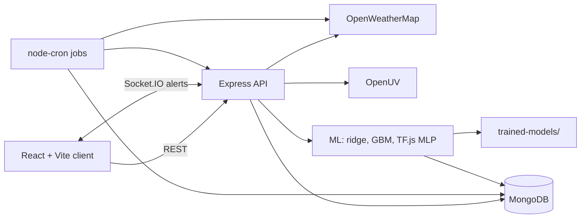

# AI Atmosphere Intelligence

Environmental intelligence platform for Indian cities: live air quality (Indian CPCB AQI method), provider weather forecasts, UV, historical analytics, our own ML pollution predictions, alerts, a data-grounded assistant, maps, comparison and PDF/CSV reports.

> Screenshots: run the app and add images to `docs/` (none are bundled).
> Informational only. Not a medical diagnostic system.

## Features
Overview with animated AQI gauge and 13 city cards · Live air (pollutant sub-indices, UV) · Weather (provider forecast charts) · AI predictions (PM2.5/PM10 at 6/12/24/48/72h, AQI from predictions, intervals, evaluation, retrain) · Leaflet map · Historical analytics + CSV export · City comparison · Smart alerts (Socket.IO) · Assistant · Reports (PDF/CSV) · JWT auth with guest mode · Node-Cron collection.

## Architecture


## Stack
Client: React 18, Vite, TypeScript, Tailwind 3, Framer Motion, Recharts, Leaflet, Lucide, React Router, Axios, Vitest + React Testing Library.
Server: Node 20+, Express, TypeScript, Mongoose, Socket.IO, node-cron, Zod, JWT, bcryptjs, Helmet, rate-limit, Winston, PDFKit, TensorFlow.js (pure JS), Jest + Supertest.

## Setup (Windows CMD)
1. Install Node.js 20 LTS and MongoDB Community (run as a service; check `mongosh --eval "db.runCommand({ping:1})"`). MongoDB 5+ recommended.
2. In the project folder:
```
copy .env.example .env
notepad .env
npm install
```
3. In `.env` set `OPENWEATHER_API_KEY`, `OPENUV_API_KEY`, and a `JWT_SECRET` from:
`node -e "console.log(require('crypto').randomBytes(48).toString('hex'))"`
4. Run: `npm run dev` (API http://localhost:5000, app http://localhost:5173).
5. Data and models:
```
npm run backfill          :: 30 days hourly pollutants for 13 cities (free OpenWeather endpoint)
npm run train             :: train all cities (or: npm run train -w server -- delhi)
npm run import:csv -w server -- ../datasets/file.csv delhi
npm test
npm run build
```
Keep the server running so the collector (every 30 min) stores weather + pollution; weather features need this history.

## MongoDB not running?
`ECONNREFUSED 127.0.0.1:27017` means MongoDB is not started. Fix: open CMD as Administrator and run `net start MongoDB`, or install MongoDB Community, or put a free MongoDB Atlas connection string in `MONGODB_URI`. In development the server falls back to a temporary in-memory database (data is lost on restart; `npm run backfill`/`train` scripts need real MongoDB, but the Backfill/Retrain buttons on the Predictions page work).

## API keys and security
Keys are read only on the server (`server/src/config/env.ts`), validated at startup, redacted from logs, never sent to the browser. `.env` is git-ignored. Helmet, CORS, rate limits, Zod validation, request timeouts, generic 500 errors.

## Data model (MongoDB)
`Observation` (city, ts UTC, source, weather + pollutant fields, aqi, uv) unique on city+ts+source · `User` · `Alert` · `Setting` (thresholds) · `PredictionLog` · `ModelMeta` (version, metrics, status).

## AQI methodology
CPCB sub-index per pollutant (PM2.5, PM10, NO2, SO2, CO in mg/m3, O3) by linear interpolation on CPCB breakpoints; AQI = max sub-index; requires 3 pollutants including a PM. Categories Good/Satisfactory/Moderate/Poor/Very Poor/Severe. **Limitation:** CPCB specifies 24h (PM, NO2, SO2) and 8h (CO, O3) averages; live feeds are instantaneous, so values are an "instant CPCB-method AQI". Prediction AQI is PM-based only.

## ML methodology
Hourly series from stored observations. Features: lags (1/3/6/24h), 24h mean, other PM, sin/cos hour (IST)/weekday/month of the target time, temperature, humidity, wind, pressure, rain. Targets: PM2.5 and PM10 at +6/12/24/48/72h, one model per city/target/horizon. Models: persistence baseline, ridge, gradient-boosted trees, TF.js MLP. 80/20 chronological split with an h-hour embargo (no target overlap); normalisation and imputation use training statistics only. Metrics MAE/RMSE/R² on hold-out; best by RMSE; `beatsPersistence` is reported honestly. Needs 300+ usable hourly samples per model, otherwise status `insufficient_data`. Intervals are ±1.96σ of hold-out residuals. Official provider forecasts are always labelled separately.

## Known limitations
- Not tested against live APIs in the build environment (no network): run the checklist below.
- OpenWeather free plans have no weather history, so weather features are missing for backfilled rows (mean-imputed) until the collector has run for a while. Pollutant-lag features carry most of the signal at first.
- Random Forest and LSTM are not implemented (GBM + MLP instead). No heatmap layer (13 points too sparse). Delhi and New Delhi are ~3 km apart, so provider values are near-identical.
- OpenUV free quota is small: UV is cached 3h and capped by `UV_DAILY_BUDGET`; some cities may show UV unavailable.
- Client tests use Vitest (Vite-native) instead of Jest.

## First-run checklist
1. `npm run dev` starts without env errors. 2. Overview shows real values (a 401 means the OpenWeather key is not active yet). 3. `npm run backfill`, then `npm run train`. 4. Predictions page shows model table. 5. `npm test`.

## Future scope
CPCB/OpenAQ adapters, 24h-average AQI, LSTM, Redis cache, deployment config.
